<!-- ===================== BANNER ===================== -->

<!-- ===================== CENA: Ryu + gerador + letreiro ===================== -->

 

 

 

 

 

 

<picture>
  <source media="(prefers-color-scheme: dark)" srcset="https://raw.githubusercontent.com/HenriqueGonzalezCruz/henriquegonzalezcruz/output/github-snake-dark.svg" />
  <source media="(prefers-color-scheme: light)" srcset="https://raw.githubusercontent.com/HenriqueGonzalezCruz/henriquegonzalezcruz/output/github-snake.svg" />
  
</picture>

 

## Som do box

  

*Em breve: o que estou ouvindo no momento.*

